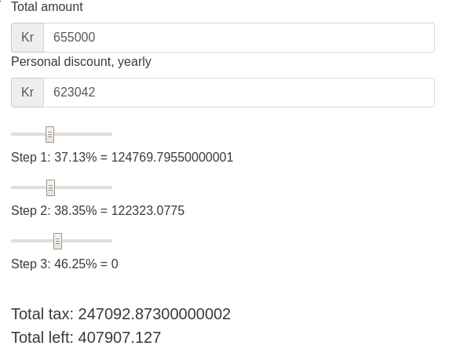

# tax-calculator
Tax steps calculator for Iceland - in vue.js and Bootstrap

[Live version here](https://viktorsmari.github.io/tax-calculator/)

You can test it locally by running `./startServer.sh`  and visiting http://localhost:8000

Run tests (Node.js 18+):

```bash
node --test tests/*.test.js
```


